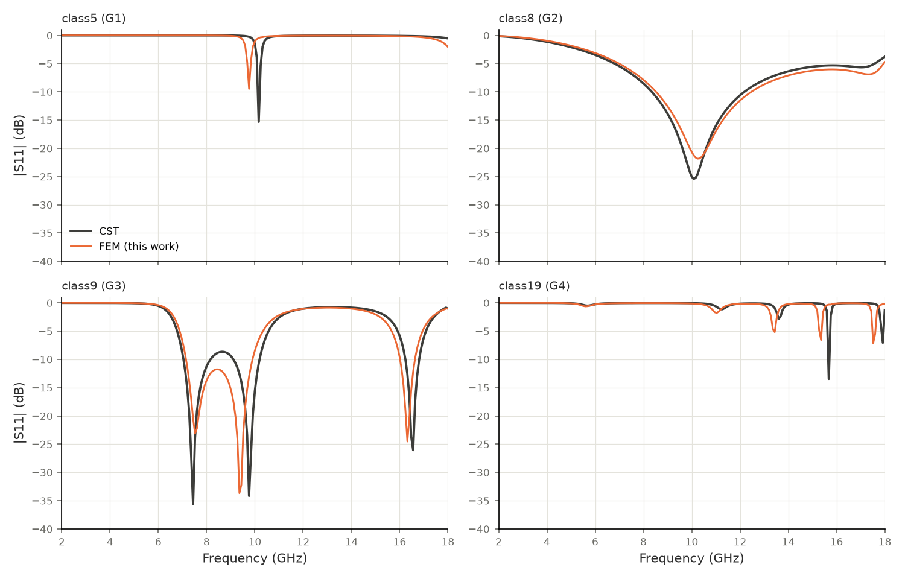

# gpu-fem-metasurface

A finite element (FEM) solver for the reflection coefficient S11 of periodic metasurface
absorbers. It models one unit cell of an infinite periodic array:

- the 3-D vector wave equation, discretised with Nédélec edge elements (order 2 by default);
- periodic side walls;
- a plane-wave (Floquet (0,0)) port above the stack;
- the metal pattern as a zero-thickness PEC, copper surface impedance or resistive sheet.

Assembly runs in PyTorch on CPU or CUDA. The linear systems are solved with MKL PARDISO on the
CPU or NVIDIA cuDSS on the GPU, including a mixed-precision mode (complex64 factorisation with
complex128 iterative refinement).

The solver is validated against CST on four absorber designs, G1 to G4. See [REPORT.md](REPORT.md)
for the full results.

## Approach

The solver meshes the whole unit cell (substrate, optional superstrate and an air region above
the pattern) with tetrahedra. It solves the curl-curl equation for the electric field at one
frequency at a time. This is the same class of model that commercial frequency-domain unit-cell
solvers use. The choice has a cost and a benefit:

- The mesh fills a 3-D volume, so the systems are large: 50k to 125k unknowns for the four
  designs at the default mesh. Almost all of the run time is the sparse direct factorisation at
  each frequency.
- Nothing in the method depends on the layers being uniform or the metal being thin. Finite metal
  thickness, vias, inhomogeneous or anisotropic layers, several patterned layers and oblique
  incidence fit into the same formulation.

The frequency-independent matrices are assembled once and recombined per frequency, so the GPU
work is the factorisation and solve. [docs/DESIGN.md](docs/DESIGN.md) gives the formulation.

## Results



Accuracy against CST. Order 2, medium mesh, 201 points from 2 to 18 GHz
(`results/accuracy_summary.md`):

| Design | CST notch (GHz, dB) | FEM notch (GHz, dB) | FEM Δf vs CST | RMSE FEM–CST (dB) |
|---|---|---|---|---|
| class5 (G1) | 10.16, −15.3 | 9.76, −9.5 | −3.9 % | 1.40 |
| class8 (G2) | 10.08, −25.4 | 10.24, −21.8 | +1.6 % | 1.10 |
| class9 (G3) | 7.44, −35.6 | 7.52, −23.1 | +1.1 % | 4.16 |
|  | 9.76, −34.2 | 9.36, −33.7 | −4.1 % |  |
|  | 16.56, −26.1 | 16.32, −24.5 | −1.4 % |  |
| class19 (G4) | 15.68, −13.5 | 15.36, −6.6 | −2.0 % | 1.48 |
|  | 17.92, −7.1 | 17.52, −7.1 | −2.2 % |  |
| class19_table1 (G4) | 15.68, −13.5 | 9.36, −20.0 | −40.3 % | 7.90 |
|  | 17.92, −7.1 | 9.36, −20.0 | −47.8 % |  |

A notch is a CST local minimum deeper than −6 dB with at least 3 dB prominence, matched to the
nearest FEM local minimum. Frequencies are on the 201-point grid (0.08 GHz step). RMSE is taken
over 2–18 GHz with dB clipped at −40 dB.

The FEM reproduces every CST notch of the four designs, with notch frequencies 1–4 % from CST.
On a finer mesh both G4 notches come within 2 % of CST. `class19_table1` is G4 built with the
parameters in the original design table (superstrate and 100 Ω/sq). Its CST column is the G4 CST curve,
which matches the structure in the CST data file (`class19`), not this one. REPORT.md section 4.4
explains.

### Sweep time on the CPU

One 201-point sweep per design (`results/timing_summary.md`):

| Design | Tets | Unknowns | Mesh (s) | Assembly (s) | Solves (s) | Per point (s) | Total 201 pts (s) | Peak RSS (MB) |
|---|---|---|---|---|---|---|---|---|
| class5 (G1) | 8,187 | 50,534 | 0.8 | 1.3 | 128 | 0.64 | 131 | 810 |
| class8 (G2) | 15,525 | 97,218 | 1.3 | 2.3 | 704 | 3.50 | 708 | 1385 |
| class9 (G3) | 19,921 | 124,682 | 0.6 | 2.8 | 2015 | 10.03 | 2019 | 2019 |
| class19 (G4) | 13,340 | 83,490 | 1.5 | 2.2 | 305 | 1.52 | 309 | 1108 |
| class19_table1 (G4) | 17,827 | 111,768 | 1.3 | 2.6 | 886 | 4.41 | 890 | 1548 |

Intel Core i5-11300H laptop CPU, 3 MKL threads, PARDISO complex-symmetric, float64, one frequency
at a time, on a machine shared with other jobs.

### GPU and mixed precision

Measured on a GeForce GTX 1650 laptop GPU (4 GB, Turing, FP64 at 1/32 of FP32). Same mesh and order,
201 points (`results/gpu_gtx1650/compare.md`):

| Design | Solver | Per point (s) | Total 201 pts (s) | Speed vs CPU PARDISO | Max dB diff vs CPU | Notch shift | Max residual |
|---|---|---|---|---|---|---|---|
| class5 (G1) | cuDSS complex128 | 0.666 | 136 | 0.96× | 0 | 0 | 2.4e-12 |
| class5 (G1) | cuDSS complex64 | 0.139 | 30 | 4.59× | 0.0034 | 0 | 8.5e-4 |
| class5 (G1) | cuDSS complex64 + refinement | 0.161 | 35 | 3.97× | 0 | 0 | 9.5e-11 |
| class19 (G4) | cuDSS complex64 + refinement | 0.341 | 72 | 4.44× | 0 | 0 | 8.7e-11 |
| class8 (G2) | cuDSS complex64 + refinement | 0.699 | 144 | 5.01× | 0 | 0 | 1.0e-10 |
| class9 (G3) | cuDSS complex64 + refinement | 1.030 | 210 | 9.73× | 0 | 0 | 9.4e-11 |

"0" means identical to the 6 significant digits stored in `s11_fem.csv`.

On this card a complex128 factorisation runs at about the CPU's speed, because FP64 is weak. A
complex64 factorisation with iterative refinement (residual formed in complex128) gives the
complex128 answer at every frequency, 4 to 10 times faster than the CPU over a 201-point sweep.
These numbers are for one consumer card. They do not predict data-centre GPU performance. REPORT.md
section 6 has the details.

## Install

The code needs Python 3.12. The commands below use [uv](https://github.com/astral-sh/uv); plain
`pip` in a virtualenv works the same way.

CPU only:

```bash
uv venv -p 3.12 .venv
uv pip install -p .venv/bin/python numpy scipy matplotlib ezdxf shapely pytest pypardiso
uv pip install -p .venv/bin/python torch --index-url https://download.pytorch.org/whl/cpu
# headless gmsh build; the standard wheel needs libGLU, which minimal Linux and WSL installs lack
uv pip install -p .venv/bin/python --index-url https://gmsh.info/python-packages-dev-nox gmsh
```

`pypardiso` is used only for the MKL runtime it ships. The solver calls PARDISO's complex-symmetric
mode directly through `ctypes`.

CUDA (tested with a GTX 1650, driver 577.00, CUDA 12.9, under WSL2):

```bash
uv pip install -p .venv/bin/python "torch==2.14.1+cu126" --index-url https://download.pytorch.org/whl/cu126 \
    --extra-index-url https://pypi.org/simple --index-strategy unsafe-best-match
uv pip install -p .venv/bin/python "nvmath-python[cu12]" cupy-cuda12x    # cuDSS
```

The CUDA stack adds about 6.5 GB to the virtualenv. Most of that is libraries torch brings and the
solver does not use (cuDNN, NCCL, cuFFT). The stock torch wheel is not built with cuDSS, so
`--solver torch` fails. Use `cudss`, `cudss32` or `cudss32ir`.

## Usage

Run a 201-point sweep from 2 to 18 GHz (order 2, medium mesh):

```bash
.venv/bin/python -m fem.sweep --design class5
.venv/bin/python -m fem.sweep --design class19_table1               # G4 with the original design table parameters
.venv/bin/python -m fem.sweep --design class5 --copper pec --tag pec  # copper as PEC instead of a surface impedance
```

On a GPU:

```bash
.venv/bin/python -m fem.sweep --design class9 --device cuda --solver cudss32ir --tag gpu_cudss32ir  # complex64 + refinement
.venv/bin/python -m fem.sweep --design class9 --device cuda --solver cudss                          # complex128
```

Run the tests:

```bash
.venv/bin/python -m pytest -q tests
```

Designs: `class5` (G1), `class8` (G2), `class9` (G3), `class19` (G4, parameters from the CST data
file), `class19_table1` (G4 as in the original design table), and `slab_<design>` (the same stack without
a pattern).

Each run writes `results/<design>[_<tag>]/`:

- `s11_fem.csv`: co- and cross-polar S11 per frequency;
- `run.json`: mesh size, timings, memory, solver residuals and machine;
- `metrics.json`: comparison with CST;
- `s11_compare.png`: the FEM and CST curves.

[docs/DEVELOPMENT.md](docs/DEVELOPMENT.md) lists the commands that regenerate every file in `results/`.

## Limitations

- Metal is zero-thickness. CST's metal thickness for these designs is not known.
- Notch frequencies are 1–4 % from CST. The medium mesh is not fully converged in thin substrates
  (about 1 % on G1). Finer meshes for G2 and G3 did not fit in the 2 GB memory budget used here.
- Normal incidence only. Oblique incidence needs a Floquet phase on the merged periodic DOFs.
- Direct solvers only. An iterative solver needs a curl-curl preconditioner (AMS / Hiptmair–Xu).
- One frequency at a time. There is no fast frequency sweep (model-order reduction) yet.
- G1 and G3 convert a large part of the incident wave to the cross polarisation at their notches,
  so for these designs absorption is not 1 − |S11|² (REPORT.md section 4.5).

## Repository layout

| Path | Content |
|---|---|
| `fem/designs.py` | the four unit cells, read from the CST data file parameter columns |
| `fem/geometry.py` | DXF to metal polygons (mm) |
| `fem/mesh.py` | gmsh layered periodic mesh that conforms to the pattern |
| `fem/elements.py`, `fem/basis.py` | Nédélec order 1 (closed form) and order 2 (hierarchical, quadrature), batched in torch |
| `fem/assembly.py` | periodic DOF numbering, shared-pattern upper-triangular CSR, device-agnostic |
| `fem/linsolve.py`, `fem/gpu.py` | PARDISO complex-symmetric and SuperLU (CPU); cuDSS complex128, complex64, complex64 + refinement and torch (GPU) |
| `fem/solver.py` | port excitation, sheet impedance, S11 extraction, sweep |
| `fem/analytic.py` | transmission-line reference for uniform stacks |
| `fem/metrics.py`, `fem/plotting.py`, `fem/sweep.py` | metrics, plots, command line |
| `scripts/` | convergence study, summary tables and plots, timing table, benchmark, GPU comparison, batch runner |
| `notebooks/kaggle_gpu_benchmark.ipynb` | a T4 benchmark notebook, prepared but not run |
| `data/` | the design patterns (DXF) and CST S11 data |
| `results/` | every result quoted in the docs |
| `docs/DESIGN.md` | formulation and design decisions |
| `docs/DEVELOPMENT.md` | how to regenerate the results, development history |

## License

MIT. See [LICENSE](LICENSE).
